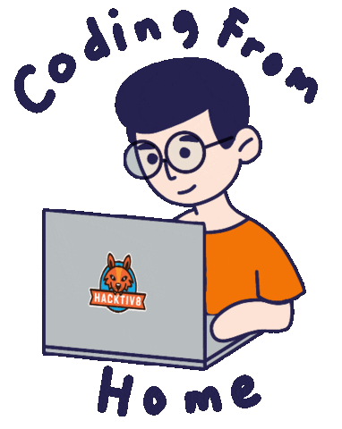

<div align="center">
    
</div>

###

<div align="center">
    <a href="https://www.linkedin.com/in/nureka-rodrigo/" target="_blank">
        
    </a>
    <a href="https://www.instagram.com/nureka_rodrigo/" target="_blank">
        
    </a>
</div>

###

<div align="center">
    
</div>

###

<h1 align="center">
    
</h1>

###

<h2 align="center">🐍 MY CONTRIBUTIONS 🐍</h2>

<div align="center">
    
</div>

###

<hr/>

###

<!--START_SECTION:waka-->


**I'm an Early 🐤** 

```text
🌞 Morning                844 commits         ██████░░░░░░░░░░░░░░░░░░░   22.55 % 
🌆 Daytime                1570 commits        ██████████░░░░░░░░░░░░░░░   41.96 % 
🌃 Evening                1205 commits        ████████░░░░░░░░░░░░░░░░░   32.20 % 
🌙 Night                  123 commits         █░░░░░░░░░░░░░░░░░░░░░░░░   03.29 % 
```
📅 **I'm Most Productive on Tuesday** 

```text
Monday                   601 commits         ████░░░░░░░░░░░░░░░░░░░░░   16.06 % 
Tuesday                  1123 commits        ████████░░░░░░░░░░░░░░░░░   30.01 % 
Wednesday                481 commits         ███░░░░░░░░░░░░░░░░░░░░░░   12.85 % 
Thursday                 599 commits         ████░░░░░░░░░░░░░░░░░░░░░   16.01 % 
Friday                   338 commits         ██░░░░░░░░░░░░░░░░░░░░░░░   09.03 % 
Saturday                 261 commits         ██░░░░░░░░░░░░░░░░░░░░░░░   06.97 % 
Sunday                   339 commits         ██░░░░░░░░░░░░░░░░░░░░░░░   09.06 % 
```


📊 **This Week I Spent My Time On** 

```text
🕑︎ Time Zone: Asia/Colombo

💬 Programming Languages: 
Markdown                 3 hrs 10 mins       █████░░░░░░░░░░░░░░░░░░░░   18.59 % 
TypeScript               3 hrs 9 mins        █████░░░░░░░░░░░░░░░░░░░░   18.49 % 
PHP                      3 hrs 6 mins        █████░░░░░░░░░░░░░░░░░░░░   18.18 % 
YAML                     1 hr 28 mins        ██░░░░░░░░░░░░░░░░░░░░░░░   08.63 % 
Bash                     1 hr 28 mins        ██░░░░░░░░░░░░░░░░░░░░░░░   08.63 % 

🔥 Editors: 
Claude Code              14 hrs 41 mins      █████████████████████░░░░   85.89 % 
IntelliJ IDEA            2 hrs 24 mins       ████░░░░░░░░░░░░░░░░░░░░░   14.11 % 

💻 Operating System: 
Windows                  17 hrs 6 mins       █████████████████████████   100.00 % 
```

🤖 **AI Coding This Week** 

```text
⏱ AI Coding Time: 15 hrs 51 mins (92.7%)

✍️ 23,410 lines written by AI, 229 lines written by hand (99.03% AI-written)

🔤 6,898,049 Input Tokens, 1,648,408 Output Tokens

💵 $109.25 Estimated AI Cost This Week

🧠 30 AI Sessions, 172 AI Prompts

Sonnet                   23,774 lines        █████████████████████████   100.00 % 

🔎 AI Coding Insights:
🤖 AI-Driven — 99.03% of written lines came from AI
📝 Concise Prompter — average 226 characters per prompt
🔁 Iterative Prompter — average 6 prompts per session
🚀 High AI Trust — 1.02% of changed lines were hand-edited
```


 Last Updated on 31/10/2026 06:05:57 UTC
<!--END_SECTION:waka-->

###

<hr/>

###

<h2 align="center">⚡ MY STATS ⚡</h2>

###

<div align="center">
    <table>
        <tr>
            <td rowspan="2" align="center">
                
            </td>
        </tr>
        <tr>
            <td align="center">
                
            </td>
        </tr>
    </table>
</div>

<div align="center">

</div>

###

<hr/>

<div align="center">
    <table>
        <tr>
            <td align="center">
                <h2>🎧 LISTEN WITH ME 🎧</h2>
                <a href="https://open.spotify.com/user/zjqfkmbawszam1irs05fwxsls">
                    
                </a>
            </td>
            <td align="center">
                <h2>👨‍💻 CODE WITH ME 👨‍💻</h2>
                
            </td>
        </tr>
    </table>
</div>

###

<hr/>
