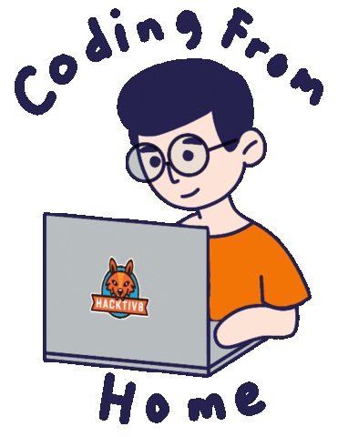
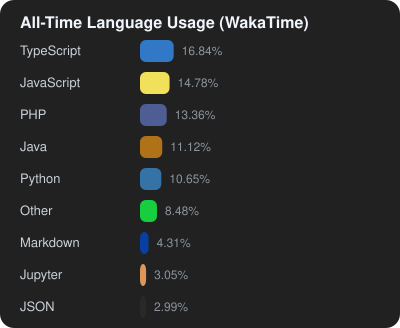

<div align="center">
    
</div>

###

<div align="center">
    <a href="https://www.linkedin.com/in/nureka-rodrigo/" target="_blank">
        
    </a>
    <a href="https://www.instagram.com/nureka_rodrigo/" target="_blank">
        
    </a>
</div>

###

<div align="center">
    
</div>

###

<h1 align="center">
    
</h1>

###

<h2 align="center">🐍 MY CONTRIBUTIONS 🐍</h2>

<div align="center">
    
</div>

###

<hr/>

###

<!--START_SECTION:waka-->


**I'm an Early 🐤** 

```text
🌞 Morning                1390 commits        ███████░░░░░░░░░░░░░░░░░░   27.01 % 
🌆 Daytime                2275 commits        ███████████░░░░░░░░░░░░░░   44.21 % 
🌃 Evening                1340 commits        ███████░░░░░░░░░░░░░░░░░░   26.04 % 
🌙 Night                  141 commits         █░░░░░░░░░░░░░░░░░░░░░░░░   02.74 % 
```
📅 **I'm Most Productive on Tuesday** 

```text
Monday                   631 commits         ███░░░░░░░░░░░░░░░░░░░░░░   12.26 % 
Tuesday                  1993 commits        ██████████░░░░░░░░░░░░░░░   38.73 % 
Wednesday                694 commits         ███░░░░░░░░░░░░░░░░░░░░░░   13.49 % 
Thursday                 845 commits         ████░░░░░░░░░░░░░░░░░░░░░   16.42 % 
Friday                   383 commits         ██░░░░░░░░░░░░░░░░░░░░░░░   07.44 % 
Saturday                 261 commits         █░░░░░░░░░░░░░░░░░░░░░░░░   05.07 % 
Sunday                   339 commits         ██░░░░░░░░░░░░░░░░░░░░░░░   06.59 % 
```


📊 **This Week I Spent My Time On** 

```text
🕑︎ Time Zone: Asia/Colombo

💬 Programming Languages: 
TypeScript               5 hrs 27 mins       █████████░░░░░░░░░░░░░░░░   34.90 % 
Markdown                 4 hrs 54 mins       ████████░░░░░░░░░░░░░░░░░   31.35 % 
Python                   1 hr 57 mins        ███░░░░░░░░░░░░░░░░░░░░░░   12.50 % 
Text                     43 mins             █░░░░░░░░░░░░░░░░░░░░░░░░   04.65 % 
CSS                      39 mins             █░░░░░░░░░░░░░░░░░░░░░░░░   04.19 % 

🔥 Editors: 
Claude Code              14 hrs 15 mins      ███████████████████████░░   91.26 % 
IntelliJ IDEA            1 hr 21 mins        ██░░░░░░░░░░░░░░░░░░░░░░░   08.74 % 

💻 Operating System: 
Windows                  15 hrs 37 mins      █████████████████████████   100.00 % 
```

🤖 **AI Coding This Week** 

```text
⏱ AI Coding Time: 15 hrs 3 mins (96.37%)

✍️ 21,718 lines written by AI, 51 lines written by hand (99.77% AI-written)

🔤 9,263,311 Input Tokens, 1,855,517 Output Tokens

💵 $165.92 Estimated AI Cost This Week

🧠 17 AI Sessions, 128 AI Prompts

Sonnet                   22,411 lines        █████████████████████████   100.00 % 

🔎 AI Coding Insights:
🤖 AI-Driven — 99.77% of written lines came from AI
📝 Concise Prompter — average 347 characters per prompt
🔁 Iterative Prompter — average 8 prompts per session
🚀 High AI Trust — 0.26% of changed lines were hand-edited
```


 Last Updated on 06/11/2026 14:32:36 UTC
<!--END_SECTION:waka-->

###

<hr/>

###

<h2 align="center">⚡ MY STATS ⚡</h2>

###

<div align="center">
    <table>
        <tr>
            <td rowspan="2" align="center">
                
            </td>
        </tr>
        <tr>
            <td align="center">
                
            </td>
        </tr>
    </table>
</div>

<div align="center">

</div>

###

<hr/>

<div align="center">
    <table>
        <tr>
            <td align="center">
                <h2>🎧 LISTEN WITH ME 🎧</h2>
                <a href="https://open.spotify.com/user/zjqfkmbawszam1irs05fwxsls">
                    
                </a>
            </td>
            <td align="center">
                <h2>👨‍💻 CODE WITH ME 👨‍💻</h2>
                
            </td>
        </tr>
    </table>
</div>

###

<hr/>
